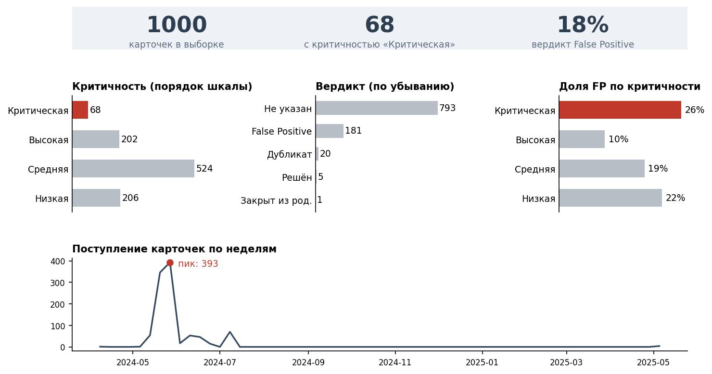

## Задание

- На основе DIKW-проекции кейса выбрать 3–5 ключевых полей из iavd_incidents_raw; определить кодировки для Критичности, Вердикта и количества алертов (карточек) с обоснованием по учебной схеме (5–7 предложений).
- Сделать эскиз обзора алертов (карточек): что выделяется преаттентивно, как группируются связанные элементы и чем кодируется Вердикт.

## 1. Ключевые поля (из DIKW-проекции СРС 1.3)

| Поле | Уровень DIKW | Тип | Зачем аналитику |
|---|---|---|---|
| Критичность | Information | порядковое (в выборке 4 уровня, в полном датасете 5) | Первый грубый фильтр очереди |
| Вердикт | Decision | номинальное (7 значений) | Решение аналитика; целевая переменная модели |
| Группа устранения | Decision | номинальное (L1 / L2 / ГИБ) | Нагрузка линий, эскалация |
| Создан | Data | время | Профиль активности, пики потока |
| Наименование (правило) | Data | номинальное, высокая кардинальность | Источник шума: какие правила дают больше всего карточек |

## 2. Кодировки

| Что кодируем | Основной канал | Дополнительно | Почему так |
|---|---|---|---|
| Критичность | Длина столбца, столбцы в порядке шкалы | Цвет: красный только у «Критической», остальные серые | Порядковая шкала читается по положению; у радужного тона нет порядка. Пропуск критической карточки (FN) дороже всего, поэтому сигнальный цвет — только ей |
| Вердикт | Длина столбца от общей нулевой линии, сортировка по убыванию, подпись значения | Цвет не используется | Номинальная категория: доли точнее сравниваются длиной, чем углом круговой; цвет занят Критичностью |
| Количество алертов (карточек) | Длина подписанных столбцов; динамика — положение точек и линии на общей временной шкале | Красная точка — только пик | Длина и положение на общей шкале — верхние уровни иерархии точности |

**Обоснование.** Критичность — упорядоченная категория из нескольких уровней, поэтому читаем ее по длине столбцов в порядке шкалы, а не по радужному тону, у которого порядка нет. Сигнальный красный отдан только уровню «Критическая»: пропуск такой карточки (FN) стоит дороже всего, остальные уровни остаются нейтрально-серыми, чтобы фокус не «выгорел». Вердикт — номинальная категория, и его доли сравниваем длиной столбцов от общей нулевой линии с сортировкой по убыванию; круговая использовала бы угол, менее точный канал. Количество карточек кодируем длиной подписанных столбцов, а динамику — положением точек и линии на общей временной шкале; это два верхних уровня иерархии. Площадь пузырьков и интенсивность цвета для точного сравнения не берем, они в нижней части иерархии. Цвет Критичности держим одинаковым на всех панелях, чтобы у аналитика формировались устойчивые шаблоны. Так редкая критическая карточка видна преаттентивно (меньше FN), а серые столбцы не отнимают внимание (дешевле FP).

## 3. Эскиз обзора карточек

- **Преаттентивно выделяется:** красный столбец «Критическая» (на панелях критичности и доли FP) и красная точка пика на таймлайне. Остальное серое.
- **Группировка:** три KPI на общей светлой плашке (общая область); три столбчатых блока в одном ряду (близость); таймлайн — один непрерывный процесс (продолжение).
- **Вердикт** кодируется длиной серых столбцов по убыванию с подписью значения; собственного цвета у вердикта нет, чтобы не конкурировать с критичностью.

Эскиз построен по реальным карточкам выборки iavd_1000 (не условные данные): 68 критических карточек, доля вердикта False Positive 18 %, пик поступления — 393 карточки за неделю 27.05–02.06.2024. На эскизе показан вердикт аналитика, а не модельная оценка.

## Соответствие чек-листу СРС (опорный конспект 2.1)

| Пункт чек-листа | Где в работе |
|---|---|
| Есть DIKW-проекция как основание выбора | Раздел 1, столбец «Уровень DIKW»; проекция — СРС 1.3 |
| Указаны 3–5 полей | Раздел 1: 5 полей |
| Отдельно названы кодировки для трех пунктов и причина каждого выбора | Раздел 2, таблица и обоснование |
| В эскизе различимы сигнальный акцент, группировка и вердикт аналитика | Раздел 3 |
| Вердикт не подменен модельным скором | Раздел 3: показан вердикт аналитика |
| Условные карточки не выдаются за реальные строки | Раздел 3: эскиз на реальной выборке, источник указан |
