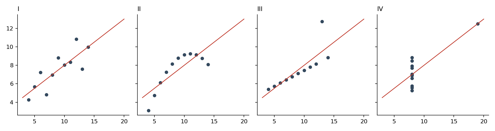
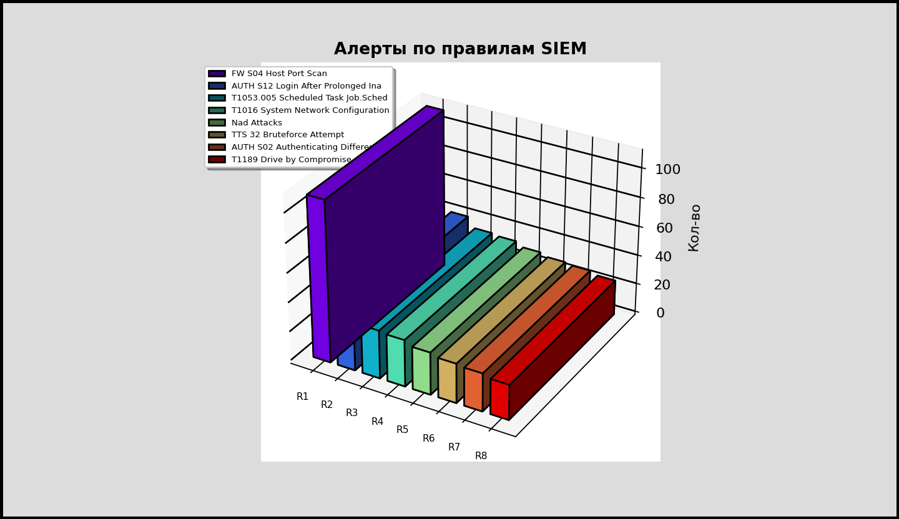
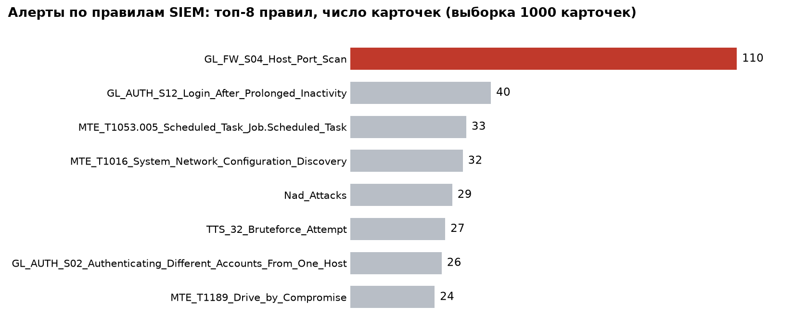

## Задание 1. Тезисы по квартету Энскомба

1. У всех четырех наборов совпадают n = 11, средние (x̄ = 9,0; ȳ ≈ 7,50), дисперсии (11,0 и ≈ 4,12), r ≈ 0,816, прямая y = 3,0 + 0,5x и R² ≈ 0,67 (пересчитано, таблица ниже), но формы разные: линейное облако, кривая, прямая с выбросом, вертикаль с одной далекой точкой.
2. Сводные числа сжимают данные и теряют форму связи, выбросы, нелинейность и кластеры. Линейная модель адекватна только набору I; в наборе II связь криволинейная, а в III и IV прямую определяет одна точка.
3. Сводки необходимы, но недостаточны: сначала смотрим на график (подход Тьюки), затем проверяем числа. В SOC одинаковое среднее число алертов или доля критических может скрывать разную динамику. Квартет показывает различие структуры данных, но не его причины.

| Набор | n | x̄ | ȳ | s²x | s²y | r | Прямая | R² |
|---|---|---|---|---|---|---|---|---|
| I | 11 | 9,0 | 7,50 | 11,0 | 4,13 | 0,816 | 3,00 + 0,50x | 0,67 |
| II | 11 | 9,0 | 7,50 | 11,0 | 4,13 | 0,816 | 3,00 + 0,50x | 0,67 |
| III | 11 | 9,0 | 7,50 | 11,0 | 4,12 | 0,816 | 3,00 + 0,50x | 0,67 |
| IV | 11 | 9,0 | 7,50 | 11,0 | 4,12 | 0,817 | 3,00 + 0,50x | 0,67 |

## Задание 2. Артефакт «до → после»

**Объект:** «Алерты по правилам SIEM» — топ-8 правил (поле «Наименование») по числу карточек в выборке из 1000 карточек. Пройдены шесть шагов чек-листа: инвентаризация, классификация, удаление безусловного мусора, работа с сеткой, легенда и подписи, цвет; затем контроль чтения.

**До**

**После**

### Удаленные и замененные элементы

| Элемент | Почему не-данные | Решение |
|---|---|---|
| 3D-эффект | Не меняется при изменении данных, искажает пропорции высот | Плоские горизонтальные столбцы |
| Тени | Не несут данных, снижают контраст | Удалены |
| Внешняя толстая рамка | Не разделяет функциональные области; границу достраивает восприятие (завершенность) | Воздух вокруг графика |
| Темная частая сетка и ось значений | Значения подписаны напрямую, сетка дублирует канал | Удалены |
| Легенда в углу (метки R1–R8) | Заставляет переводить взгляд «столбец → угол → столбец» | Полные названия правил подписаны у столбцов (близость) |
| Радужная заливка | У тона нет порядка, он создает ложные различия | Серая база и один красный фокус на самом частом правиле |

Сохранены как функциональные: столбцы, подписи значений, названия правил, заголовок (единица «число карточек» и объем выборки вынесены в него вместо отдельной подписи оси).

### Спорные элементы и условия решения

| Элемент | Решение в «после» | Условие, при котором решение меняется |
|---|---|---|
| Сетка и ось значений | Убраны | Вернуть редкую бледную сетку за данными, если подписи значений убраны (например, при 20+ столбцах) или нужно сравнение с порогом / нормой |
| Легенда | Заменена прямыми подписями | Вернуть легенду рядом с графиком, если появится разбивка по сериям (например, по критичности) и прямые подписи начнут накладываться |
| Красный фокус на GL_FW_S04_Host_Port_Scan | Оставлен: правило дает 11 % потока и в 2,75 раза опережает следующее — главный кандидат на настройку | Если задача графика — нейтральное сравнение правил без вывода, все столбцы серые; красный в обзоре зарезервирован за сигналом «требует реакции» |
| Длинные технические названия правил | Оставлены полностью | Сокращать до кода правила (GL_FW_S04 и т. п.) только при узком месте на дашборде и с полным названием во всплывающей подсказке |

### Качественная оценка доли не-данных элементов

До: из 10 элементов (столбцы, подписи значений, подписи осей, заголовок, рамка, сетка, легенда, тени, 3D, заливки) 6 были чистым украшением, сетка — спорной. После: остались 4 функциональных элемента (столбцы, подписи значений, названия правил, заголовок), декоративных нет. Доля не-данных элементов заметно снизилась; численный Data-ink ratio не рассчитывался — оценка качественная.

### Контроль чтения

Главный сигнал читается за 3–5 секунд: правило GL_FW_S04_Host_Port_Scan (110 карточек) примерно в 2,75 раза чаще следующего (40). Необходимый контекст не потерян: единица и объем выборки указаны в заголовке, значения подписаны, названия правил полные. Проверка выполнена самостоятельно, без внешних испытуемых.
