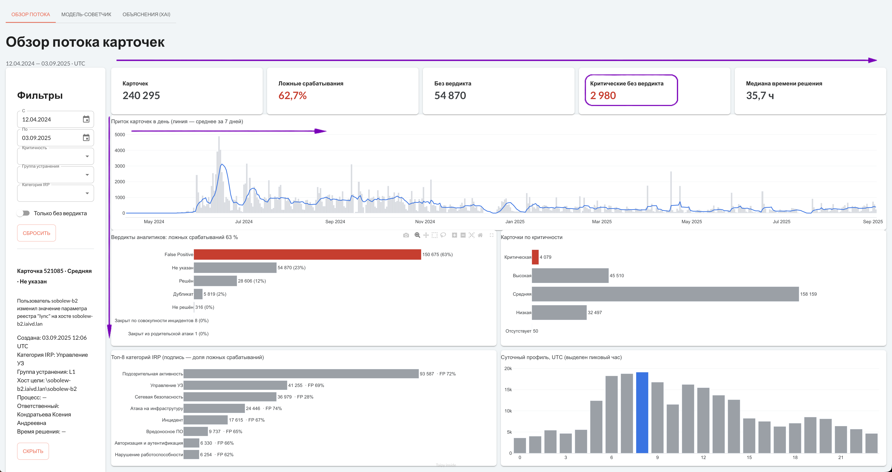

# СРС 2.3 · Траектория взгляда и правило 8 секунд

**Команда** – Храмов Владислав, Гарбуз Александр, Семенов Илья.

**Группа** – 5130201/40101. **Трек** – ML-инжиниринг.

## Задание

Изучить раздатку «Рекомендации по выбору диаграмм v1.0». Выбрать экран дашборда и отметить на скриншоте предполагаемый путь взгляда (F- или Z-паттерн). В 3–5 предложениях объяснить, удачно ли расположены ключевые элементы и можно ли понять главное за 8 секунд. [Презентация занятия 2.3, слайд 43](<../../materials/2.3_Л_Дашборд/2.3_Л_Дашборд_Презентация.pdf#page=43>)

## Экран обзора Taipy

Дежурному аналитику нужно быстро увидеть, сколько критических карточек осталось без вердикта. На обоих снимках выбран весь период с 12.04.2024 по 03.09.2025 (UTC).

### Путь взгляда

Предполагаем F-паттерн – сначала взгляд идёт слева направо по верхнему ряду показателей, затем проходит по началу графика притока и спускается по левому краю к деталям. Рамкой выделено число критических карточек без вердикта – **2 980**. Правило 8 секунд оцениваем по раскладке экрана, без замера времени чтения.

### До перестановки

**Вывод.** Правило 8 секунд выполняется частично – число критических карточек видно сразу на экране, но оно стоит четвёртым и конкурирует за внимание с красной долей ложных срабатываний.

### После перестановки

**Вывод.** Правило 8 секунд выглядит выполнимым – ключевое число стоит первым в ряду и попадает в зону первого внимания.
