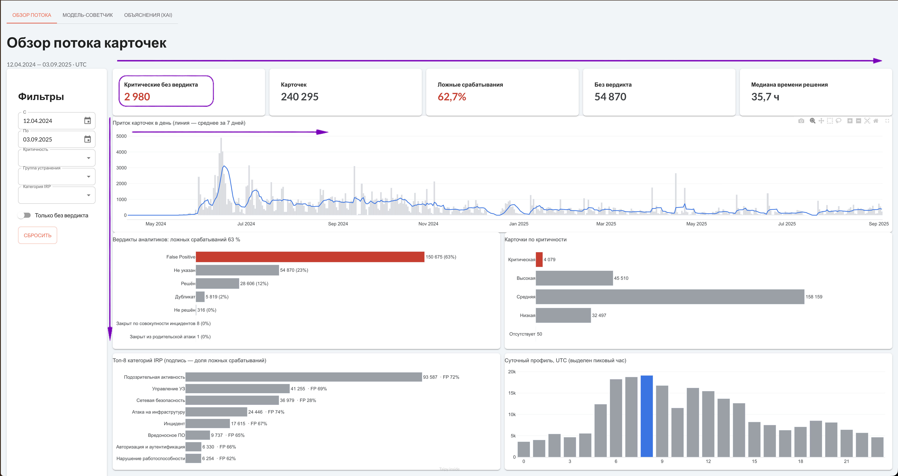

# СРС 2.3 · Траектория взгляда и правило 8 секунд

**Команда** — Храмов Владислав, Гарбуз Александр, Семенов Илья.  
**Группа** — 5130201/40101. **Трек** — ML-инжиниринг.

## Задание

Изучить раздатку «Рекомендации по выбору диаграмм v1.0». Выбрать экран дашборда, наложить на скриншот предполагаемую траекторию взгляда (F- или Z-паттерн) и в 3–5 предложениях обосновать расположение ключевых элементов и оценить соблюдение правила 8 секунд. [Презентация занятия 2.3, слайд 43](<../../materials/2.3_Л_Дашборд/2.3_Л_Дашборд_Презентация.pdf#page=43>)

## Экран обзора Taipy

Вопрос дежурного аналитика — сколько критических карточек в выбранном периоде осталось без вердикта. На обоих снимках показан весь доступный период, с 12.04.2024 по 03.09.2025 (UTC). Стрелки отмечают предполагаемый порядок чтения, а рамка выделяет ключевой показатель.

**До перестановки.** «Критические без вердикта» — четвёртая карточка в ряду.

**После перестановки.** «Критические без вердикта» — первая карточка в ряду.

## Обоснование

Плотный обзор с фильтрами слева и рядом KPI сверху предполагает F-паттерн: первый проход идёт слева направо по показателям, второй короче и захватывает начало графика притока, затем взгляд спускается по левому краю основной области к деталям. Раньше первичным якорем ряда было общее число карточек, а до показателя «Критические без вердикта» нужно было пройти три соседних KPI, включая выделенную красным долю ложных срабатываний. После перестановки ключевое число **2 980** находится в начале первого прохода, в зоне первичного фокуса. По расположению элементов правило 8 секунд выполнялось частично до перестановки и выглядит выполнимым после неё. Время чтения оцениваем по макету, без замера на пользователях.
