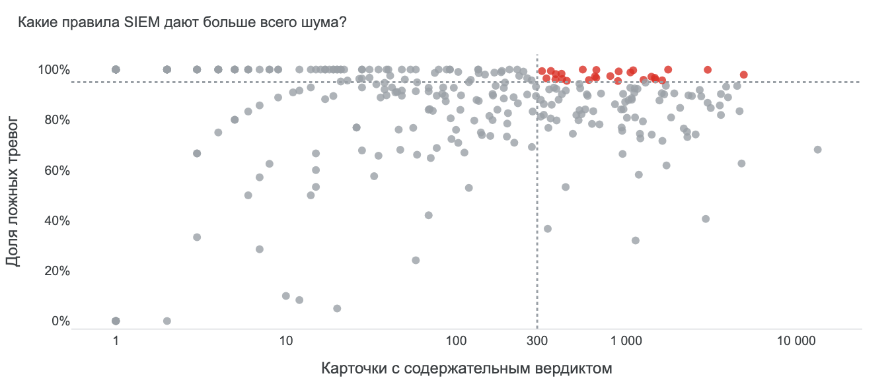
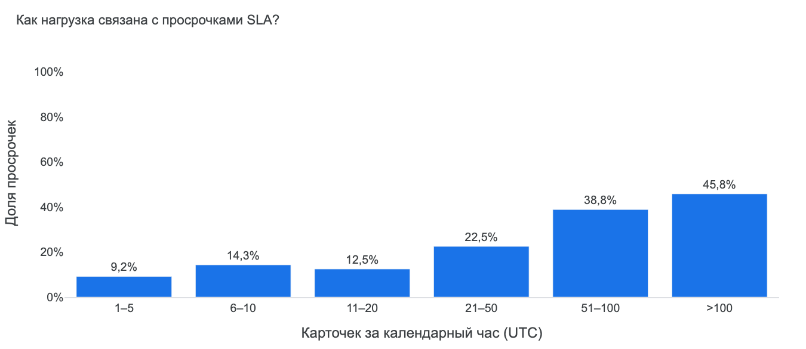
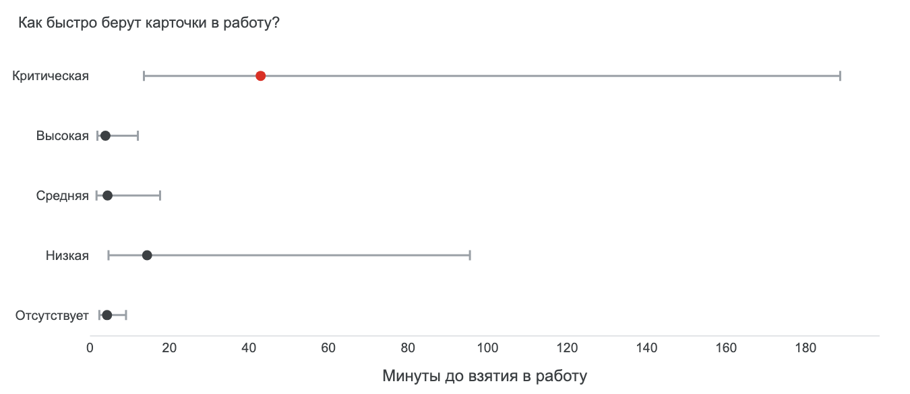

# СРС 2.4 · EDA-гипотезы по потоку SOC

**Команда** – Храмов Владислав, Гарбуз Александр, Семенов Илья.

**Группа** – 5130201/40101. **Трек** – ML-инжиниринг.

## Задание

Сформулировать 2–3 бизнес-гипотезы по полям `iavd_incidents_raw` в формате «гипотеза → поле → график для проверки» и проверить рабочее окружение ML-трека. [Конспект занятия 2.4, раздел 8](<../../materials/2.4_Л_EDA/2.4_Л_EDA_Опорный_конспект_v01.docx>)

Взяли полный датасет `iavd_incidents_raw_target.parquet` – 240 295 карточек с 12.04.2024 по 03.09.2025 (UTC). В Conda с Python 3.11 проверили, что parquet читается, графики строятся и обзор Taipy открывается.

- **SIEM (Security Information and Event Management)** – система управления информацией и событиями безопасности. Она собирает события из разных источников и формирует алерты по правилам корреляции.
- **SLA (Service Level Agreement)** – соглашение об уровне обслуживания. Здесь нас интересует срок, за который аналитик должен взять карточку в работу.

| Гипотеза | Поля | График для проверки |
|---|---|---|
| Небольшая группа правил SIEM даёт почти одни ложные тревоги и охватывает больше 10% разобранных карточек. | `Правило корреляции SIEM`, `Вердикт` | Каждая точка – правило. По X – число карточек, по Y – доля ложных тревог (FP). Пунктир отмечает пороги 300 карточек и 95% FP. |
| В часы с большим притоком выше доля просрочек взятия в работу. | `Создан`, `SLA просрочен (взятие в работу)` | Столбцы по диапазонам часовой нагрузки. Высота – доля карточек с просрочкой. |
| Критические карточки дольше ждут взятия в работу, чем остальные. | `Критичность`, `Создан`, `Дата взятия в работу`, `SLA по взятию в работу Атаки` | Точка показывает медиану времени ожидания, отрезок – диапазон для центральных 50% карточек. |

## Результаты

### 1. Шумные правила SIEM

Карточки со статусами «Не указан» и «Дубликат» и карточки с пустым вердиктом исключили. Для каждого указанного правила построили точку. На логарифмической оси помещаются и редкие, и частые правила.



Порог прошли **26 из 326 правил**. На них приходится **27 956 из 179 606** разобранных карточек (15,6%), из которых **27 347** – ложные тревоги.

**Вывод.** Гипотеза подтвердилась – 26 правил с долей ложных тревог от 95% дают 15,6% разобранных карточек, что выше порога в 10%.

### 2. Нагрузка и SLA

Нагрузка часа – число **всех** карточек, созданных в один календарный час UTC. Доля просрочек рассчитана по 184 219 карточкам с известным флагом SLA. По 56 076 карточкам флаг отсутствует.



| Карточек в час | Карточек с известным флагом | Доля просрочек |
|---|---:|---:|
| 1–5 | 8 381 | 9,2% |
| 6–10 | 11 400 | 14,3% |
| 11–20 | 24 970 | 12,5% |
| 21–50 | 53 564 | 22,5% |
| 51–100 | 43 641 | 38,8% |
| >100 | 42 263 | 45,8% |

**Вывод.** Гипотеза в целом подтвердилась – при высокой нагрузке доля просрочек выше, хотя растёт она не в каждом соседнем диапазоне.

### 3. Время реакции по критичности

Время ожидания считаем от создания карточки до взятия в работу. Исключили 48 371 карточку без даты взятия и 33 036 карточек, у которых эта дата раньше даты создания. Сроки из SLA перевели из миллисекунд в минуты и сравнили со временем ожидания каждой карточки.



| Критичность | Карточек со временем реакции | Медиана, мин | Карточек с нормативом | Взяты позже норматива |
|---|---:|---:|---:|---:|
| Критическая | 2 605 | 42,9 | 2 605 | 87,3% |
| Высокая | 25 769 | 3,9 | 25 743 | 36,2% |
| Средняя | 114 450 | 4,4 | 114 446 | 30,3% |
| Низкая | 16 021 | 14,4 | 16 021 | 50,0% |
| Отсутствует | 43 | 4,3 | 43 | 7,0% |

**Вывод.** Гипотеза подтвердилась среди карточек с корректным временем взятия – у критических карточек самая высокая медиана ожидания (42,9 минуты).

## Воспроизведение

Те же расчёты используются в интерактивном обзоре. Для пересчёта и экспорта PNG в окружении ML дополнительно нужны Kaleido и установленный Chrome или Chromium. Команды из корня репозитория:

```bash
cd ML
poetry run python -m pip install kaleido
poetry run python ../DV/scripts/srs24_charts.py
```

[Сценарии проектного обзора SOC](../../ML/docs/SOC_overview.md)
