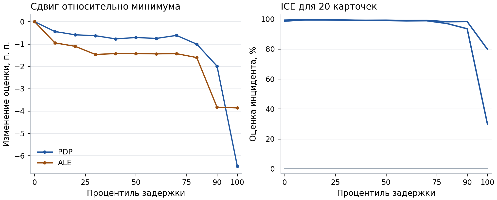

Задание из раздела 10 опорного конспекта 3.3. Сравниваем три способа объяснить поведение модели, проверяем два рейтинга важности и разбираем карточку из своего набора.

## 1. Частичная зависимость, ICE и ALE

Выбрали `create_lag_s` – задержку создания карточки в секундах. PDP и ALE посчитаны по тесту из 3 173 карточек, ICE показывает 20 отдельных карточек. По горизонтали идут процентили распределения, поэтому равные шаги на графике соответствуют разным интервалам по времени.

- **PDP** подставляет одну и ту же задержку всем карточкам и усредняет оценку. До 70-го процентиля средняя оценка держится около 12 %. На 90-м она равна 10,75 %, на максимуме – 6,27 %.
- **ICE** показывает, как меняется оценка каждой карточки. Большую часть падения на правом краю дают две из двадцати кривых. На максимуме задержки их оценки падают с 98,24 % до 79,77 % и с 93,45 % до 29,84 % относительно 90-го процентиля.
- **ALE** считает локальное изменение по карточкам из каждого интервала задержки. Между 90-м процентилем (около 10,4 часа) и максимальным значением (около 203 суток) PDP падает на 4,48 п. п., а ALE – на 0,03 п. п. При подстановке крайней задержки в PDP могут появиться редкие сочетания с другими временными полями, например с возрастом события.

**Вывод.** Для самой большой задержки общее снижение на PDP слабо подтверждается ALE, а ICE показывает, что сильное падение сосредоточено в двух карточках из подвыборки.

## 2. Важность SHAP и выключение поля

Средний модуль вклада SHAP показывает, насколько сильно поле двигает логарифм шансов на тесте. Ablation измеряет среднее абсолютное изменение вероятности при выключении поля вместе с его производными признаками на 80 контрольных карточках. Последний столбец таблицы переведён в процентные пункты.

| Поле | Место SHAP | Средний модуль SHAP | Место ablation | Среднее изменение, п. п. |
|---|---:|---:|---:|---:|
| Hostname атакующего | **1** | 0,833 | **1** | 1,643 |
| Hostname Цели | **2** | 0,737 | **3** | 1,308 |
| `src_is_private` | **3** | 0,705 | **4** | 1,024 |
| Команда | **4** | 0,688 | 7 | 0,610 |
| Алерт | **5** | 0,565 | 11 | 0,319 |
| Создан | 7 | 0,524 | **2** | 1,634 |
| `dst` | 8 | 0,512 | **5** | 0,848 |

На всех 73 полях корреляция рангов равна 0,83. Методы используют разные выборки и шкалы. Один и тот же сдвиг в логарифме шансов слабее меняет вероятность около 0 или 1, чем в середине шкалы. При ablation «Команды» и «Алерта» выключаются сразу по 50 производных признаков.

**Вывод.** Оба метода вывели в топ-5 имена хостов и признак частного IP источника, а поле «Создан» поднялось с седьмого места по SHAP на второе по ablation.

## 3. Карточка для разбора · FP 527528

Аналитик поставил «False Positive», а модель оценила вероятность инцидента в 15,38 % при пороге около 1,93 %. Оценку сильнее всего подняло поле «Создан» (+1,3978 в логарифме шансов). Далее идут «Hostname атакующего» (+0,9842) и число элементов группировки (+0,8564).

**Вывод.** Для разбора в СРС 3.4 выбрали 527528, чтобы проверить, отражает ли большой вклад времени создания устойчивую закономерность на более поздних карточках.

## 4. Логарифм шансов и сумма вкладов

Берём оценку карточки из `cards_practice.csv`, порог из `spec.json` и вклады из `shap_cards.csv` комплекта ML 3.7.

| Проверка | Результат |
|---|---|
| Перевод p в логарифм шансов, ln(p / (1 − p)) | p = 0,153838 → z ≈ −1,7048107 |
| Перевод порога в ту же шкалу | τ ≈ 0,01925874 → zτ ≈ −3,9303437 |
| База плюс сумма 73 вкладов | −8,852417 + 7,1476028 ≈ −1,7048142 |
| Вероятность из суммы, 1 / (1 + exp(−z)) | 0,1538375483 |

Расхождение в вероятности – 4,52·10⁻⁷. Это меньше половины последнего знака в исходной оценке, округлённой до шести знаков после запятой.

**Вывод.** Сумма вкладов восстанавливает оценку с точностью до округления, и оба расчёта дают решение «инцидент», поскольку z примерно на 2,23 выше порога.
