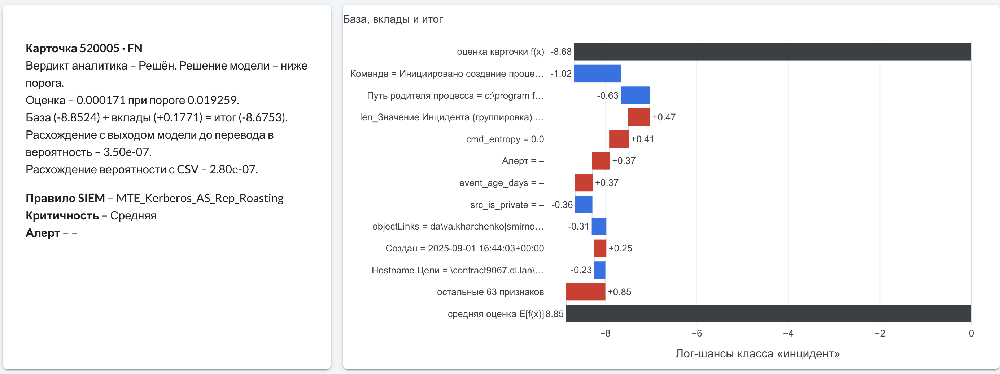
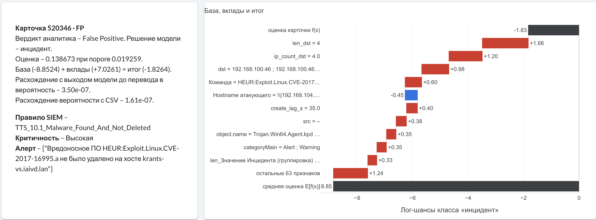

По заданию из опорного конспекта 3.4 (раздел 14) строим водопады для пропущенного инцидента и ложной тревоги, проверяем сумму вкладов и выбираем карточку для разбора на практике 3.7.

## Как читаем водопад

Модель отмечает инцидент при оценке от 0,01925874 (около 1,93 %). На водопаде расчёт идёт в логарифме шансов z. База модели равна −8,8524, а порогу соответствует z = −3,9303. Десять самых крупных по модулю вкладов показаны отдельно, остальные 63 суммируются в последнюю ступень. Вклад со знаком плюс поднимает оценку инцидента, вклад со знаком минус снижает её.

## FN 520005 · Пропущенный инцидент

Модель дала p = 0,000171, аналитик поставил «Решён». Сильнее всего оценку снизили «Команда» (−1,0201) и «Путь родителя процесса» (−0,6252). Среди положительных вкладов выделяются число элементов группировки (+0,4651) и энтропия команды (+0,4110). Сумма остальных 63 вкладов – +0,8474. Итог на 4,7450 единицы z ниже порога.

Все десять вкладов и исходные значения можно посмотреть на [скриншоте таблицы FN](../img/pr37_team13_fn_520005_top10.png).

В решении аналитик сослался на похожую карточку, которую уже передали на вторую линию поддержки. Поле «Алерт» в исходной карточке пустое.

**Вывод – данные.** Стоит проверить, была ли связь с предыдущим срабатыванием доступна на момент прогноза, поскольку модель оценила карточку существенно ниже порога, а аналитик использовал эту связь при разборе.

## FP 520346 · Ложная тревога

Модель дала p = 0,138673, аналитик поставил «False Positive». Самые большие вклады дали длина списка адресов назначения `len_dst` (+1,6596), число записей IP `ip_count_dst` (+1,2030) и само поле адресов `dst` (+0,9806). В списке было четыре записи и два разных адреса. Сумма остальных 63 вкладов – +1,2374. Итог на 2,1040 единицы z выше порога.

Все десять вкладов и значения сетевых полей видны на [скриншоте таблицы FP](../img/pr37_team13_fp_520346_top10.png).

**Вывод – признак.** Стоит испытать счётчик уникальных IP на тестовой выборке, поскольку в этой карточке модель учитывает список с повторяющимися адресами сразу через несколько полей.

## Проверка аддитивности

К базе прибавили все 73 вклада из `shap_cards.csv`. Полученный z сравнили с прямым выходом LightGBM в режиме `raw_score=True`. Отдельно перевели z в вероятность p = 1 / (1 + exp(−z)) и сверили с `cards_practice.csv`.

| Карточка | База + сумма вкладов (округлено) | Ошибка в z | p из CSV |
|---|---|---:|---:|
| 520005 | −8,8524 + 0,1771 ≈ −8,6753 | 3,50·10⁻⁷ | 0,000171 |
| 520346 | −8,8524 + 7,0261 ≈ −1,8264 | 3,50·10⁻⁷ | 0,138673 |

**Вывод.** Для всех восьми карточек расхождение с прямым выходом модели не превысило 3,50·10⁻⁷, а с вероятностью из CSV – 4,52·10⁻⁷.

## Выводы по набору № 13

В наборе по две карточки каждого исхода. FN – пропущенный инцидент, FP – ложная тревога модели, TN – правильно распознанное ложное срабатывание, TP – правильно распознанный инцидент.

| Карточка | Исход | Оценка | Что проверить |
|---|---|---:|---|
| 520005 | FN | 0,000171 | **Данные.** Был ли доступен контекст связанного инцидента. |
| 519995 | FN | 0,000216 | **Данные.** У того же правила снова снижают оценку команда и путь родительского процесса. Проверить, можно ли связать карточку с исходным срабатыванием на момент прогноза. |
| 520346 | FP | 0,138673 | **Признак.** Проверить счётчик уникальных адресов назначения. |
| 527528 | FP | 0,153838 | **Признак.** Проверить, сохраняется ли большой вклад времени создания на более позднем потоке. |
| 521973 | TN | 0,000018 | **Признак.** Проверить на новых данных, сохраняется ли отрицательный вклад имени целевого хоста на похожих карточках. |
| 523198 | TN | 0,000020 | **Признак.** Проверить на более свежих данных, сохраняется ли вклад частоты правила. |
| 521518 | TP | 0,939609 | **Данные.** Проверить заполнение имени объекта и адреса источника, которые дали два крупнейших вклада. |
| 526498 | TP | 0,943415 | **Данные.** Проверить заполнение имени целевого хоста и корректность признака частного адреса источника. |

**Вывод.** Чтобы исправить FN 520005, порог пришлось бы опустить до 0,000171, а для исправления FP 520346 – поднять выше 0,138673, поэтому одним сдвигом порога обе ошибки не устранить.

## Карточка для обсуждения · FP 527528

Модель дала 0,153838 при вердикте аналитика «False Positive». Крупнейший вклад дало время создания (+1,3978). Также заметны «Hostname атакующего» (+0,9842) и число элементов группировки (+0,8564). По этой карточке нельзя понять, отражает ли время создания полезную закономерность или особенности периода обучения.

**Вывод – признак.** Проверим вклад поля «Создан» на срезах по времени и сравним качество версий модели с этим полем и без него.
