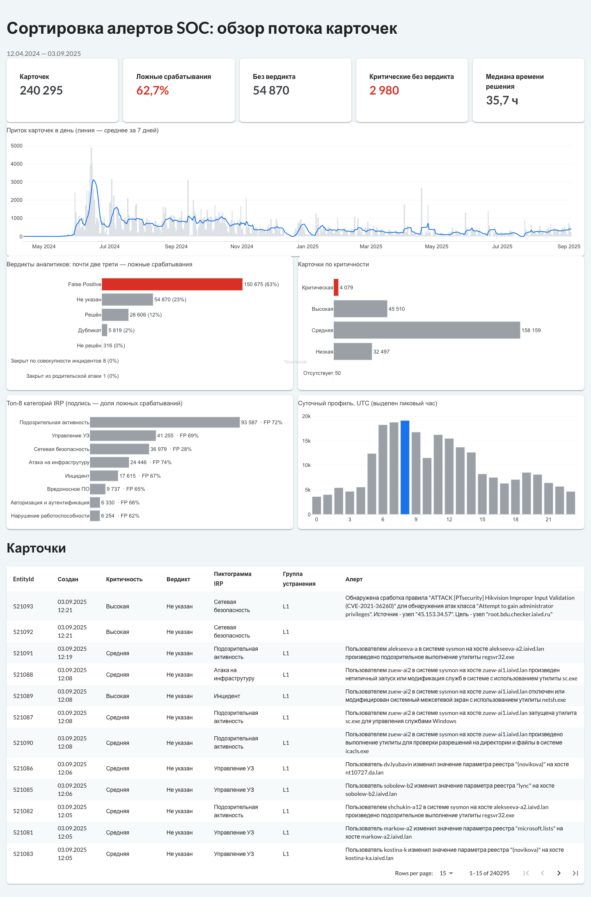
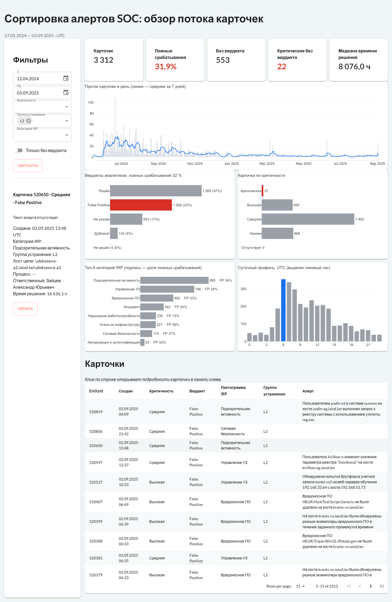
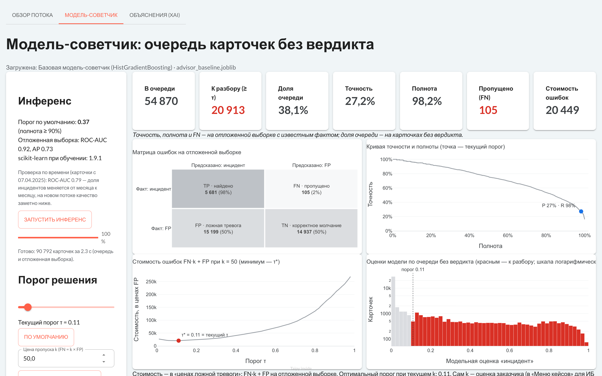
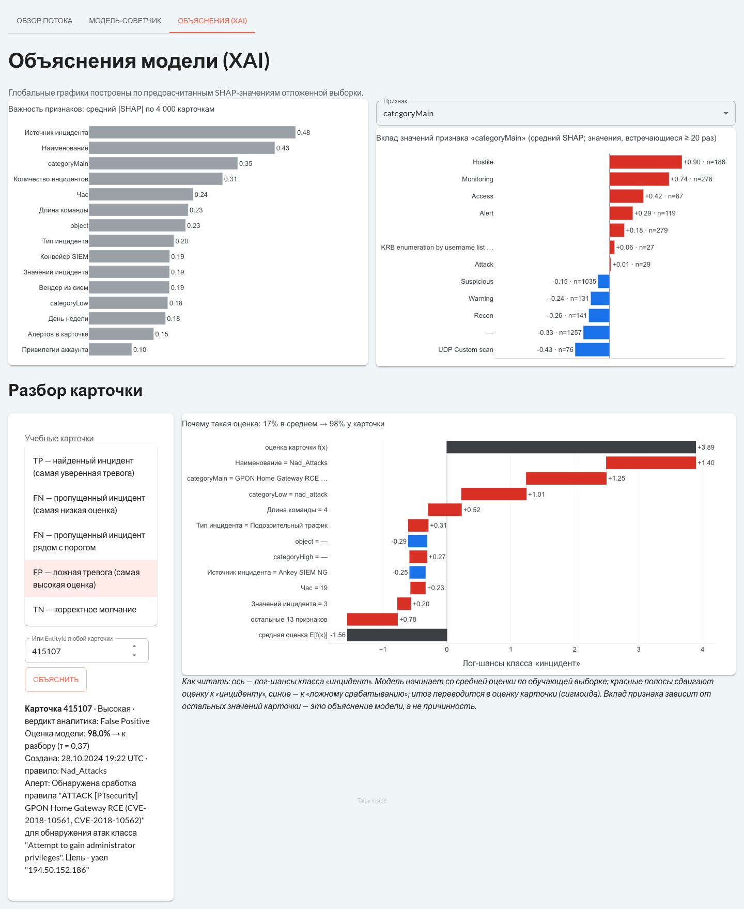
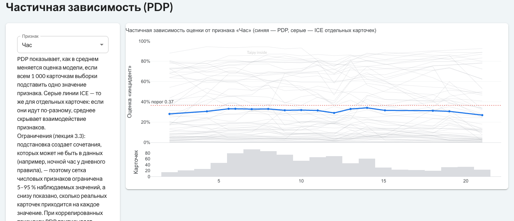

# Taipy-приложение «Сортировка алертов SOC» (трек ML-инжиниринг)

Групповой проект по курсу ИАиВД. Приложение показывает поток карточек SIEM и (по мере прохождения практик)
результаты ML-модели-советчика и их объяснения (XAI).

| Практика | Что реализовано |
|---|---|
| 2.5 Интерфейсы | Разметка страницы Taipy, загрузка DataFrame из parquet, KPI, графики Plotly, таблица карточек |
| 2.6 Интерактивность | State и callbacks: панель фильтров (период, критичность, группа, категория IRP, «без вердикта»), пересчет KPI/графиков/таблицы, сброс, детали карточки по клику на строку |
| 3.6 Интеграция ML | Страница «Модель-советчик»: загрузка `.joblib` при старте сервера, пакетный инференс очереди без вердикта (54 870 карточек) и отложенной выборки в фоновом потоке через `invoke_long_callback` с прогресс-баром; порог τ, матрица ошибок, кривая точности и полноты, очередь по убыванию оценки |
| 3.7 XAI | SHAP (TreeExplainer): waterfall оценки по клику на карточку в очереди; страница «Объяснения (XAI)» — глобальная важность и вклад значений признака по предрасчитанным SHAP-массивам, разбор учебных карточек TP/FN/FP/TN и любой карточки по EntityId |
| Порог по стоимости | Поле «цена пропуска k», кривая стоимости ошибок FN·k + FP и кнопка τ* на странице модели: при k = 50 τ* = 0,11 — к разбору 38 % очереди при полноте 98,2 % |
| 3.8 Подготовка к КТ1 | PDP + ICE на вкладке XAI (в фоне через `invoke_long_callback`), проверка двух одновременных клиентов, [чек-лист самопроверки](docs/KT1_self_review.md) |

## Запуск

```bash
cd ML
poetry install
cd app && poetry run python main.py   # http://127.0.0.1:5050
```

Датасет по умолчанию берется из `lecture/Dataset/iavd_incidents_raw_target.parquet`
(в репозиторий не входит); другой путь можно задать переменной `IAVD_DATA`.
Время карточек показывается в UTC, как в контрольных числах банка EDA.

## Модель-советчик

Предобученной модели курса (`.joblib`) пока нет в материалах, поэтому обучена базовая модель
с тем же интерфейсом (`predict_proba` на таблице признаков):

```bash
cd ML && poetry run python model/train_baseline.py
```

- Положительный класс — реальный инцидент (как в СРС к 3.2), «Не указан» и «Дубликат» без эталона исключены.
- Признаки — только известные при создании карточки (критичность, категория IRP, правило корреляции,
  процесс, теги, час, масштаб); поля, заполняемые в ходе разбора, исключены, чтобы не было утечки таргета.
- HistGradientBoosting, стратифицированное разбиение 80/20: ROC-AUC 0,92, AP 0,73; порог 0,37 выбран
  как максимальный при полноте ≥ 90 % (точность 42 %).
- Категории подаются порядковыми кодами, без нативных категориальных сплитов: с ними TreeExplainer
  давал SHAP-значения, не сходящиеся с выходом модели (ошибка аддитивности ~7 лог-шансов). Сейчас сумма
  базы и вкладов совпадает с оценкой модели до 1e-14.
- **Дрейф:** при проверке по времени (обучение на ранних 80 %, оценка на последних 20 %) ROC-AUC 0,79 —
  доля инцидентов по месяцам меняется от 3 % до 28 %. Предупреждение выводится в приложении.
- `advisor_baseline_shap.npz` — предрасчитанные SHAP-значения по 4 000 карточкам отложенной выборки
  (для глобальных графиков); локальные объяснения считаются на лету (~3 мс на карточку).

Модель курса подключается без правки кода: `IAVD_MODEL=/путь/к/model.joblib poetry run python main.py`
(рядом можно положить `model.json` с порогом `threshold`). Если она ожидает другой набор признаков,
нужно поправить `build_features` в `app/advisor.py`.

## Структура

- `app/data.py` — загрузка parquet (только нужные поля), подготовка признаков, KPI.
- `app/charts.py` — фигуры Plotly: одна серая палитра, красный только для сигнала «требует реакции».
- `app/main.py` — точка входа: навигация и запуск Gui.
- `app/pages/overview.py` — «Обзор потока»: State и callbacks (`on_filter`, `on_reset`, `on_row`).
- `app/pages/advisor.py` — «Модель-советчик»: `on_run` → `invoke_long_callback` → `on_status`, `on_threshold`, `on_queue_row`.
- `app/pages/xai.py` — «Объяснения (XAI)»: глобальная важность, вклад значений признака, учебные карточки.
- `app/explain.py` — SHAP-объяснение одной карточки (общий код двух страниц).
- `docs/KT1_self_review.md` — требования рубрикатора ↔ реализация, ограничения, ответы на вопросы ревью.
- `app/advisor.py` — признаки, разметка, загрузка модели, инференс (общий для приложения и обучения).
- `model/` — скрипт обучения, `advisor_baseline.joblib`, метаданные `.json`, EntityId отложенной выборки.
- `docs/` — скриншоты для отчета по практикам.

## Проверка по контрольным числам банка EDA

| Срез | Приложение | Контроль |
|---|---|---|
| Все карточки | 240 295; FP 62,7 %; медиана решения 35,7 ч | 1.1, 2.2, 4.6 |
| Группа L2 | 3 312; FP 31,9 %; медиана 8 076 ч | 3.9, 5.10, 4.9 |
| Пиковый час (UTC) | 8:00 | 4.4 |










