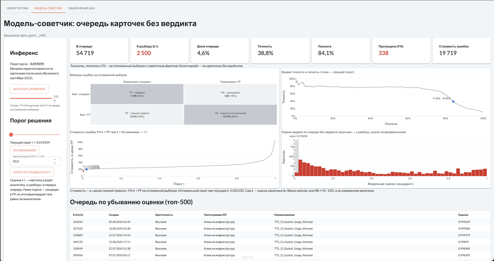
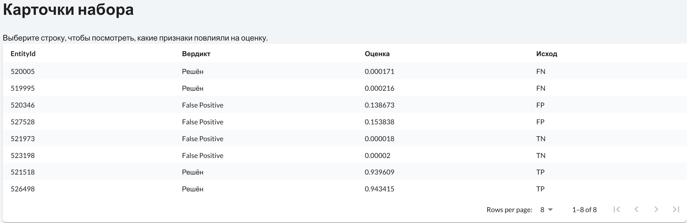
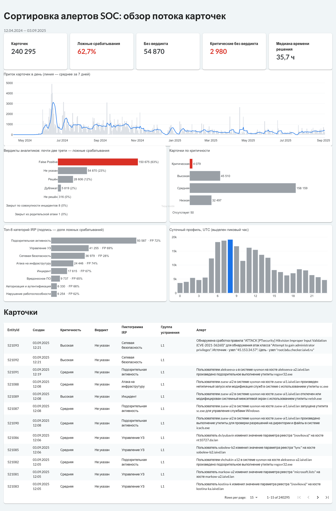
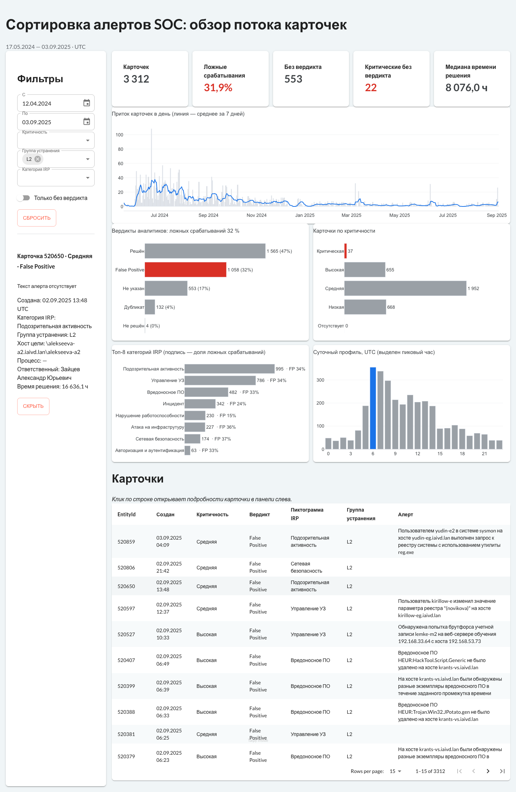
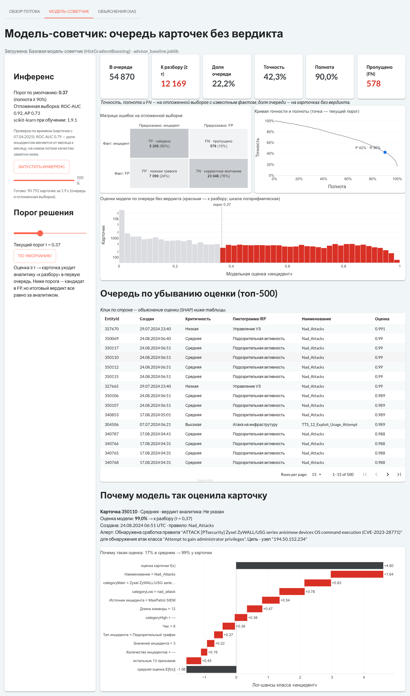
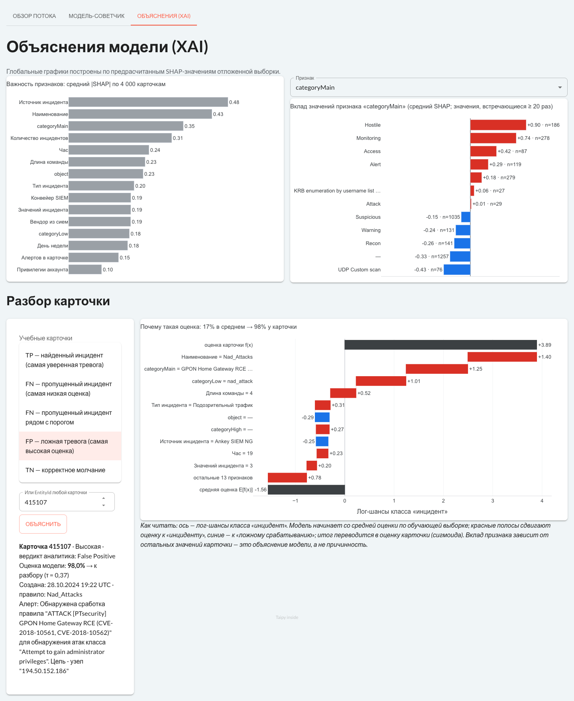
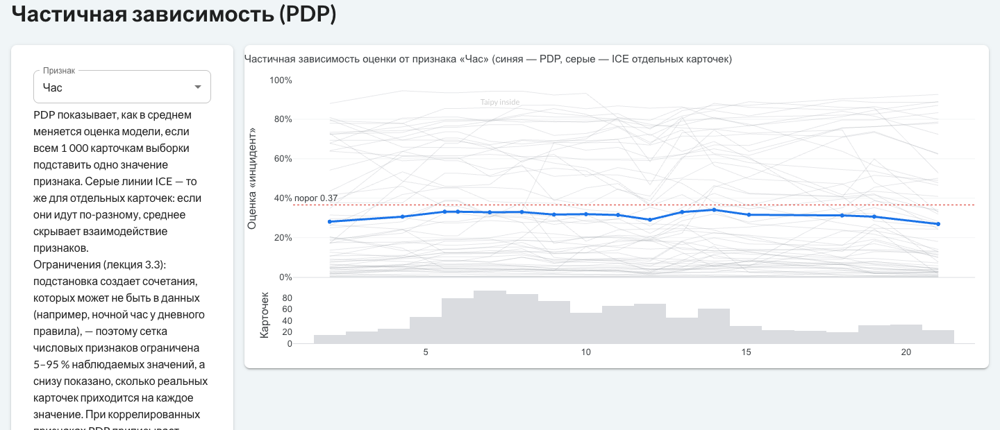

# Taipy-приложение «Сортировка алертов SOC» (трек ML-инжиниринг)

Групповой проект по курсу ИАиВД. Приложение показывает поток карточек SIEM и (по мере прохождения практик)
результаты ML-модели-советчика и их объяснения (XAI).

[Проектный обзор карточек SOC](docs/SOC_overview.md) связывает пять вопросов руководителя с графиками Taipy и результатами СРС 2.4.

| Практика | Что реализовано |
|---|---|
| 2.5 Интерфейсы | Разметка страницы Taipy, загрузка DataFrame из parquet, KPI, графики Plotly, таблица карточек |
| 2.6 Интерактивность | State и callbacks: панель фильтров (период, критичность, группа, категория IRP, «без вердикта»), пересчет KPI/графиков/таблицы, сброс, детали карточки по клику на строку |
| 3.6 Интеграция ML | Модель курса `lgbm_gate1__v001` загружается вместе с препроцессором. Прогнозы считаются пакетами в фоновом потоке через `invoke_long_callback`. На странице видны прогресс, очередь по оценке, порог, матрица ошибок и кривая точности и полноты. |
| 3.7 XAI | Для модели курса есть вкладка «Почему так?» с выбором набора, SHAP-водопадом и сравнением важности на практике и тесте. |
| Порог по стоимости | Поле «цена пропуска k», кривая стоимости ошибок FN·k + FP и кнопка τ* на странице модели: при k = 50 τ* = 0,11 — к разбору 38 % очереди при полноте 98,2 % |
| 3.8 Подготовка к КТ1 | PDP + ICE на вкладке XAI (в фоне через `invoke_long_callback`), проверка двух одновременных клиентов, [чек-лист самопроверки](docs/KT1_self_review.md) |

## Запуск

```bash
cd ML
poetry install
cd app && poetry run python main.py   # http://127.0.0.1:5050
```

Датасет по умолчанию берется из
`materials/Datasets/Задание 1: Датасет карточек сок + календарь/iavd_incidents_raw_target.parquet`.
Каталог `materials/` игнорируется Git. Другой путь можно задать переменной `IAVD_DATA`.
Время карточек показывается в UTC, как в контрольных числах банка EDA.

## Запуск с моделью курса

Распакуйте `IAVD_3.7_ML_team.zip` в `materials/3.7_Пр_XAI/`. Для модели используйте Python 3.11 и версии библиотек из `pyproject.toml` комплекта. Команды из корня репозитория:

```bash
course_kit="$PWD/materials/3.7_Пр_XAI/IAVD_3.7_ML_team"
(
  cd "$course_kit"
  poetry env use python3.11
  poetry install
  poetry run python models/lgbm_gate1__v001/predict_demo.py
)
cd ML/app
IAVD_COURSE_KIT="$course_kit" "$course_kit/.venv/bin/python" main.py
```

Контрольный скрипт сверяет пять прогнозов. При запуске Taipy через `IAVD_COURSE_KIT` модель использует `model.joblib`, `preproc.joblib` и остальные файлы своей версии. Порог по умолчанию берётся из `run.json` (около 0,019259).

- **Очередь** берётся из `materials/Datasets/Задание 2: Инференс модели/Под обучение/iavd_ml_dataset.parquet`. В неё входят карточки без вердикта. Другой parquet с той же схемой можно задать через `IAVD_COURSE_DATA`.
- **Проверочная выборка** берётся из того же файла за период после окна обучения. По разметке модели курса «Решён» означает инцидент, а `False Positive` – ложную тревогу. Метрики в Taipy рассчитываются по этой выборке при выбранном пороге.
- **Обзор потока** читает датасет из задания 1. Показатели обзора и размер очереди модели могут различаться, поскольку источники данных разные.

На материалах курса контрольный скрипт воспроизвёл все пять прогнозов с максимальным расхождением 3,98·10⁻⁷. В Taipy кнопка инференса обработала 74 643 карточки: 54 719 в очереди и 19 924 в проверочной выборке. При пороге курса полнота составила 84,1%, точность – 38,8%.



## Качество модели на учебном логе

Вкладка **«Качество модели»** открывается по адресу `/inference` при обычном запуске приложения. Она читает сохранённые прогнозы `wlarf-dec-jun-v3` из `materials/Datasets/Задание 2: Инференс модели/Готовые данные/MODEL_PREDICTIONS_target.parquet`. Другой путь можно указать через `IAVD_INFERENCE_LOG`. Вкладка «Модель-советчик» проводит инференс на своей модели.

На странице можно менять период, группировать пропуски по четырём полям и выбирать порог вручную или кнопками 0,18 и 0,00498. Для качества берутся карточки с меткой, для нагрузки – все прогнозы выбранного периода. [Отчёт по проектной части 2](docs/model_quality.md).

## Почему так

Запустите приложение с моделью курса и откройте вкладку «Почему так?». Выберите согласованный номер набора. Taipy покажет восемь карточек и откроет первую с исходом FN (пропущенный инцидент). По строке таблицы можно открыть любую карточку набора и сравнить её с FN.

Водопад строится по готовым вкладам из `course_pack/shap_cards.csv`. Он показывает базу, десять самых больших вкладов, сумму остальных вкладов и итог в логарифме шансов. В таблице рядом видно, какие значения взяты из карточки, а какие признаки рассчитаны при подготовке данных.

Проверка по 320 карточкам дала максимальные расхождения 3,50·10⁻⁷ между суммой вкладов с базой и выходом модели до перевода в вероятность, а также 5,00·10⁻⁷ между восстановленной вероятностью и округлённым значением в CSV. Исходы при пороге курса совпали на всех карточках.

Для сравнения важности с тестом положите `IAVD_3.7_BI_team.zip` рядом с распакованным комплектом ML. Приложение читает из архива готовую таблицу важности для той же модели. В практике и тесте совпадают первые три признака. Частота правила входит в пятёрку на практике, а в тестовую пятёрку вместо неё входит текст алерта.

### Набор № 13

[Записка по практике 3.7](../DV/pdf/pr_3.7_why.pdf) и [отчёт СРС 3.4](../DV/pdf/srs_3.4_local_shap.pdf).



| Карточка | Водопад | Топ-10 и значения признаков |
|---|---|---|
| FN 520005 · пропущенный инцидент | [Скриншот](../DV/img/pr37_team13_fn_520005_waterfall.png) | [Скриншот](../DV/img/pr37_team13_fn_520005_top10.png) |
| FP 520346 · ложная тревога | [Скриншот](../DV/img/pr37_team13_fp_520346_waterfall.png) | [Скриншот](../DV/img/pr37_team13_fp_520346_top10.png) |

## Объяснения на потоке

Вкладка **«Объяснения на потоке»** (`/shap-flow`) использует готовые вклады модели курса на срезе `productive_20584`. Для запуска укажите `IAVD_COURSE_KIT`, положите `IAVD_3.7_BI_team.zip` рядом с комплектом ML и оставьте `iavd_ml_dataset.parquet` в каталоге «Под обучение» задания 2 либо задайте `IAVD_COURSE_DATA`.

На вкладке можно сравнить средние вклады с долями инцидентов, изменить категорию IRP и открыть водопад любой карточки среза по её ID. [Отчёт по проектной части 3](docs/shap_flow.md).

## Базовая модель

При обычном запуске из окружения проекта используется собственная baseline-модель. Её можно переобучить:

```bash
cd ML && poetry run python model/train_baseline.py
```

- Положительный класс — реальный инцидент (как в СРС к 3.2), «Не указан» и «Дубликат» без эталона исключены.
- Признаки — только известные при создании карточки (критичность, категория IRP, правило корреляции,
  процесс, теги, час, масштаб); поля, заполняемые в ходе разбора, исключены, чтобы не было утечки таргета.
- HistGradientBoosting, стратифицированное разбиение 80/20: ROC-AUC 0,92, AP 0,73; порог 0,37 выбран
  как максимальный при полноте ≥ 90 % (точность 42 %).
- Категории подаются порядковыми кодами, без нативных категориальных сплитов: с ними TreeExplainer
  давал SHAP-значения, не сходящиеся с выходом модели (ошибка аддитивности ~7 лог-шансов). Сейчас сумма
  базы и вкладов совпадает с оценкой модели до 1e-14.
- **Дрейф:** при проверке по времени (обучение на ранних 80 %, оценка на последних 20 %) ROC-AUC 0,79 —
  доля инцидентов по месяцам меняется от 3 % до 28 %. Предупреждение выводится в приложении.
- `advisor_baseline_shap.npz` — предрасчитанные SHAP-значения по 4 000 карточкам отложенной выборки
  (для глобальных графиков); локальные объяснения считаются на лету (~3 мс на карточку).

Для другой модели с интерфейсом и признаками baseline можно задать `IAVD_MODEL=/путь/к/model.joblib`. Рядом можно положить `model.json` с порогом `threshold`. Режим курса включается через `IAVD_COURSE_KIT` и использует свою проверочную выборку.

## Структура

- `app/data.py` — загрузка parquet (только нужные поля), подготовка признаков, KPI.
- `app/charts.py` — фигуры Plotly: одна серая палитра, красный только для сигнала «требует реакции».
- `app/main.py` — точка входа: навигация и запуск Gui.
- `app/pages/overview.py` — «Обзор потока»: State и callbacks (`on_filter`, `on_reset`, `on_row`).
- `app/pages/advisor.py` — «Модель-советчик»: `on_run` → `invoke_long_callback` → `on_status`, `on_threshold`, `on_queue_row`.
- `app/pages/inference.py` – «Качество модели», недельные и групповые срезы и сравнение порогов по учебному логу.
- `app/pages/xai.py` — «Объяснения (XAI)»: глобальная важность, вклад значений признака, учебные карточки.
- `app/explain.py` — SHAP-объяснение одной карточки (общий код двух страниц).
- `docs/KT1_self_review.md` — требования рубрикатора ↔ реализация, ограничения, ответы на вопросы ревью.
- `app/advisor.py` — признаки, разметка, загрузка модели, инференс (общий для приложения и обучения).
- `model/` — скрипт обучения, `advisor_baseline.joblib`, метаданные `.json`, EntityId отложенной выборки.
- `docs/` — скриншоты для отчета по практикам.

## Проверка по контрольным числам банка EDA

| Срез | Приложение | Контроль |
|---|---|---|
| Все карточки | 240 295; FP 62,7 %; медиана решения 35,7 ч | 1.1, 2.2, 4.6 |
| Группа L2 | 3 312; FP 31,9 %; медиана 8 076 ч | 3.9, 5.10, 4.9 |
| Пиковый час (UTC) | 8:00 | 4.4 |











## Презентация к защите

Презентация с аналитическим нарративом (завязка → кульминация → развязка, 13 слайдов) собрана как
Artifact «Модель-советчик для очереди SOC» в claude.ai и скачивается из него в .pptx / PDF. Все числа
на слайдах воспроизводятся в приложении (страница «Модель-советчик», k = 50 → «Порог по стоимости»).
