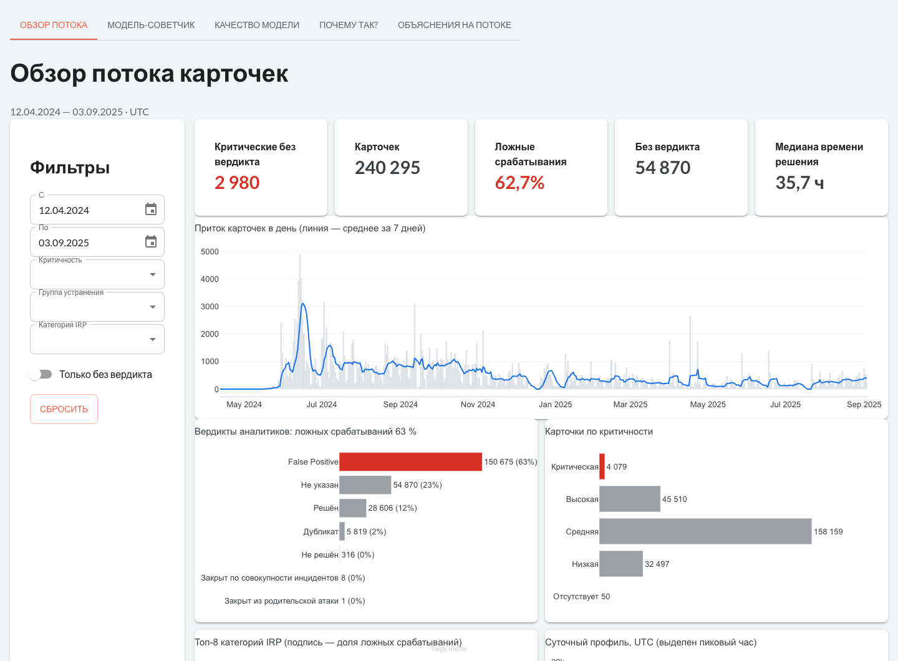
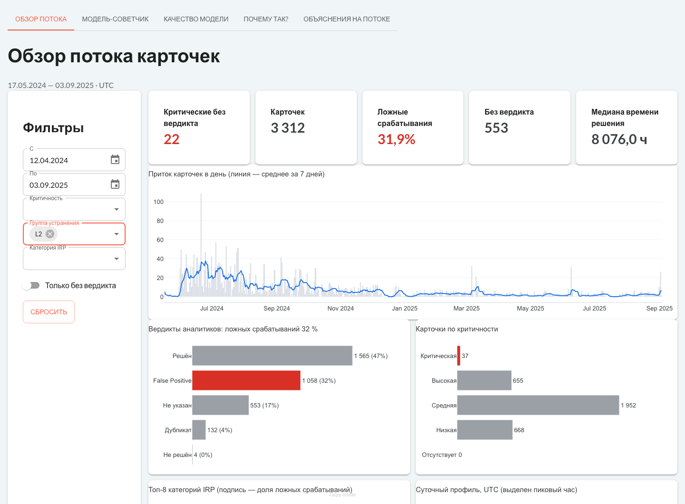
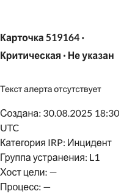

# Проект · Карточки SOC

Обзор предназначен для руководителя SOC. Он показывает, где нужна проверка очереди, правил SIEM или времени реакции. Контрольные числа ниже относятся ко всему доступному периоду с 12.04.2024 по 03.09.2025 (UTC). Фильтры Taipy позволяют повторить анализ по периоду, критичности, группе устранения и категории IRP.

| Вопрос руководителя | Ответ на полном срезе | Как читать обзор и почему выбран график |
|---|---|---|
| Сколько карточек без вердикта требуют приоритетного внимания? | 54 870 карточек без вердикта, из них 2 980 критических. | Первым KPI вынесено число критических карточек без вердикта, рядом общий объём очереди. Для просмотра списка выбрать «Критическая» и включить «Только без вердикта». По клику на строку открываются детали. |
| Когда растёт нагрузка на SOC? | Часовой максимум за весь период приходится на 08:00 UTC, когда создано 19 118 карточек суммарно. | Суточные столбцы позволяют сравнить часы. Дневные столбцы показывают всплески, а недельное скользящее среднее помогает увидеть устойчивые изменения. |
| С каких правил начать работу над ложными тревогами? | 26 частых правил с долей FP от 95% охватывают 15,6% карточек с содержательным вердиктом. | Точечный график показывает объём и долю FP одновременно. В подсказке видны название правила и число ложных тревог. |
| Как меняется соблюдение SLA в часы пик? | Доля просрочек взятия составляет 9,2% при 1–5 карточках в час и 45,8% при потоке свыше 100. | Столбцы позволяют сравнить доли между диапазонами нагрузки. В подсказке указан знаменатель, а нагрузка часа берётся по всему потоку для сопоставимости срезов. |
| Какие карточки дольше всего ждут взятия в работу? | У критических карточек медиана ожидания 42,9 минуты, 87,3% взяты позже индивидуального норматива. | Точка и интервал между квартилями показывают типичное ожидание и разброс. В подсказке указана доля превышений норматива. |

## Примеры работы с обзором

**Полный период.** На первом месте стоит число критических карточек без вердикта.

**Группа L2.** Показатели и графики пересчитаны для выбранной группы.

**Детали выбранной карточки.** На примере критической карточки без вердикта видны дата создания, категория и группа устранения.

[Расчёты и оговорки по выборке](../../DV/src/srs_2.4_eda_hypotheses.md)
