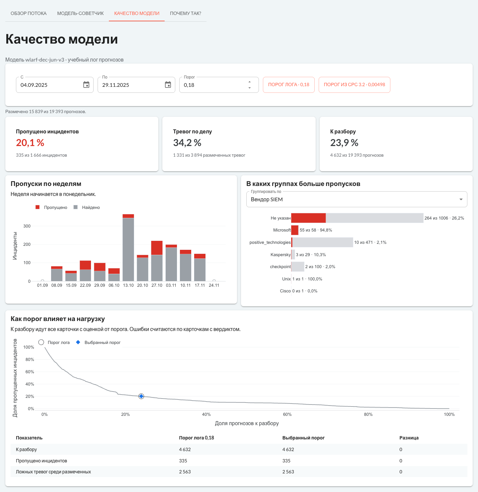
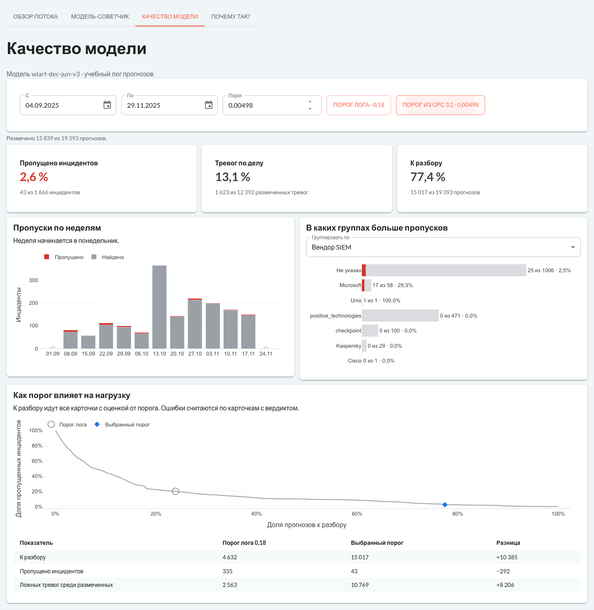

# Проект, часть 2. Качество модели на учебном логе

На вкладке «Качество модели» руководитель центра мониторинга и реагирования (SOC) может оценить, сколько инцидентов теряется при выбранном пороге и сколько карточек получат аналитики.

Источник – `MODEL_PREDICTIONS_target.parquet` из комплекта практики 3.6. В логе 19 393 сохранённых прогноза модели `wlarf-dec-jun-v3` за 04.09–29.11.2025. Метрики качества считаются по 15 839 прогнозам с допустимой меткой (`Flag_ValidLabel = 1`). Среди них 1 666 инцидентов. В расчёте нагрузки участвуют все прогнозы за выбранный период.

## 1. Сколько реальных инцидентов пропускает модель?

При исходном пороге 0,18 модель пропустила 335 из 1 666 инцидентов (20,1 %). Среди 3 894 размеченных карточек, которые попали бы к аналитику, было 1 331 реальных инцидентов (34,2 %). В верхнем ряду дашборда первой показана доля пропусков, под ней – количество и знаменатель.

**Вывод.** При пороге 0,18 модель помогает расставить приоритеты в очереди, но оставляет ниже порога примерно каждый пятый инцидент.

## 2. В какие недели и в каких группах пропусков больше?

На недельном графике красная часть столбца показывает пропуски, а весь столбец – число инцидентов. По числу пропусков выделяется неделя с 27 октября (77 из 220, 35 %). В неделю с 22 сентября пропусков меньше по числу, но больше по доле (50 из 112, 44,6 %).

В разрезе вендоров больше всего пропусков в группе «Не указан» (264 из 1 006). У Microsoft пропущено 55 из 58 инцидентов (94,8 %), у `positive_technologies` – 10 из 471 (2,1 %). Вкладка позволяет переключиться на конвейер SIEM, категорию IRP или критичность. Серый столбец показывает, сколько инцидентов в группе, красный – сколько из них пропущено.

**Вывод.** Средняя доля пропусков по потоку скрывает большие различия между неделями и группами карточек.

## 3. Как снижение порога меняет нагрузку?

На графике по горизонтали – доля всех прогнозов к разбору, по вертикали – доля пропущенных инцидентов среди размеченных. Таблица под графиком показывает разницу с порогом лога для текущего периода.

| Показатель | Порог лога 0,18 | Порог из СРС 3.2, 0,00498 | Изменение |
|---|---:|---:|---:|
| К разбору, весь лог | 4 632 (23,9 %) | 15 017 (77,4 %) | +10 385 |
| Пропущено инцидентов | 335 (20,1 %) | 43 (2,6 %) | −292 |
| Ложные тревоги среди размеченных | 2 563 | 10 769 | +8 206 |

**Вывод.** Порог 0,00498 уменьшает число пропусков на 292, но увеличивает очередь более чем втрое, поэтому перед эксплуатацией нужно проверить пропускную способность аналитиков.
