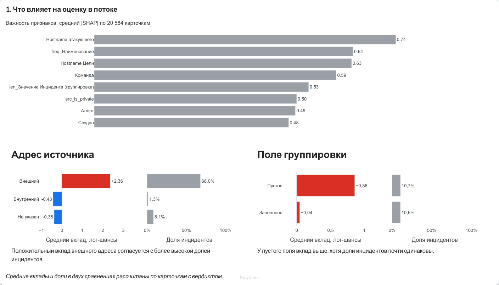
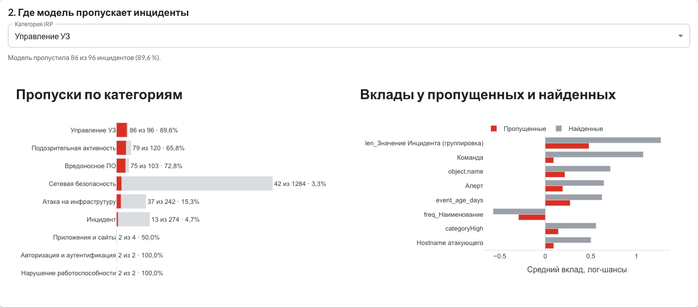
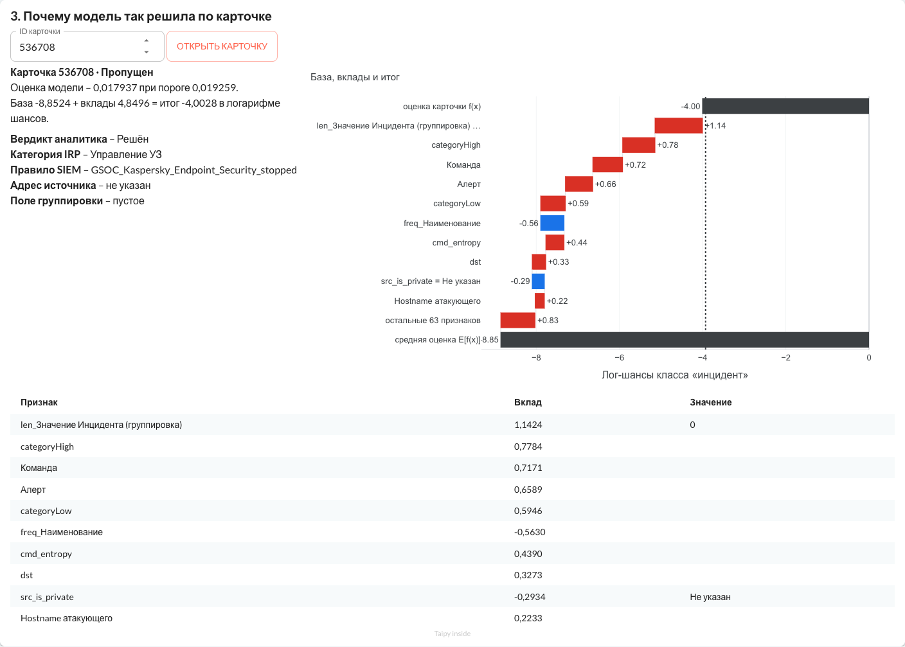

# Проект, часть 3. Объяснения модели на потоке SOC

Проверяем, какие признаки влияют на решения модели и согласуются ли её доводы с вердиктами аналитиков. Используем срез эксплуатации `productive_20584` из комплекта 3.7. В нём 20 584 карточки, из которых 19 924 размечены. У модели `lgbm_gate1__v001` рабочий порог 0,019259. Из 2 127 инцидентов модель пропустила 338 (15,9 %).

По каждой карточке прибавили к базе все 73 вклада и перевели сумму из логарифма шансов в вероятность. Максимальное расхождение с сохранённой оценкой – 3,54·10⁻⁷. Решения при рабочем пороге совпали на всех карточках.

## 1. Поток – какие доводы подтверждают данные?

Чем больше средний модуль SHAP на потоке, тем сильнее признак обычно меняет оценку. Для двух признаков сравнили **средний вклад** со знаком и **долю инцидентов** среди размеченных карточек с тем же значением.

| Признак и значение | Размечено | Средний вклад, лог-шансы | Доля инцидентов |
|---|---:|---:|---:|
| Адрес источника · внешний | 1 158 | +2,36 | 68,0 % |
| Адрес источника · внутренний | 2 563 | −0,43 | 1,3 % |
| Адрес источника · не указан | 16 203 | −0,38 | 8,1 % |
| Поле группировки · пустое | 11 311 | +0,86 | 10,7 % |
| Поле группировки · заполнено | 8 613 | +0,04 | 10,6 % |

Тип адреса определяем по тому же признаку `src_is_private`, что использует модель. Если адресов несколько, учитываем весь список. Пустое поле группировки означает, что после разбора списка в нём нет элементов.

**Вывод.** Данные подтверждают направление вклада внешнего адреса, а положительный вклад пустой группировки выглядит сомнительно, поскольку доля инцидентов почти та же, что при заполненном поле.

## 2. Группа – чем пропуски отличаются от найденных инцидентов?

В «Управлении УЗ» модель пропустила 86 из 96 инцидентов (89,6 %), в «Сетевой безопасности» – 42 из 1 284 (3,3 %). Столбцы на панели показывают и число пропусков, и общий размер каждой группы инцидентов.

В категории «Управление УЗ» отдельно сравнили средние вклады для 86 пропущенных и 10 найденных инцидентов. Например, вклад «Команды» в среднем равен +0,09 у пропущенных и +1,08 у найденных. У «Алерта» разница похожая – +0,19 и +0,64 соответственно.

**Вывод.** В категории «Управление УЗ» команда и алерт дают меньший вклад у пропущенных инцидентов, поэтому полезно проверить сами поля этих карточек.

## 3. Карточка – почему модель пропустила 536708?

Аналитик поставил «Решён», а модель дала 0,017937 при пороге 0,019259. На водопаде видно, что база −8,8524 и сумма вкладов +4,8496 дают итог −4,0028, примерно на 0,07 ниже порога в логарифме шансов. Самый большой положительный вклад (+1,1424) дало пустое поле группировки. По данным всего потока у пустого поля доля инцидентов почти такая же, как у заполненного.

**Вывод.** Объяснение показывает, почему оценка осталась ниже порога, а сильный вклад пустой группировки требует проверки по другим полям карточки.
